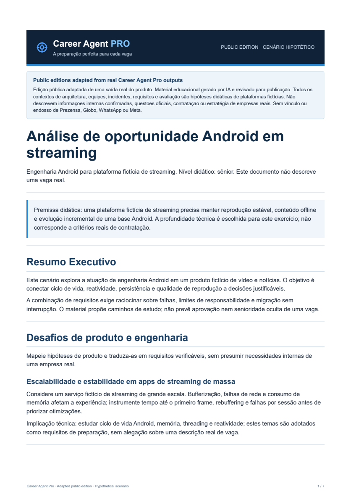
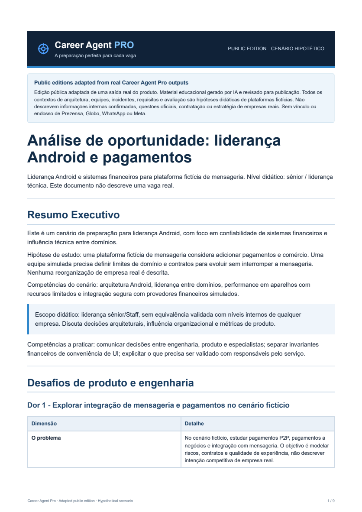

# Hi, I'm Jean Santini 👋

### Senior Android Engineer · Mobile Platform & SDKs · AI Engineering

I'm a software engineer with **10+ years of Android development experience**, specializing in financial technology, payment SDKs, mobile security, and maintainable mobile architecture. I've worked on SmartPOS payment integrations, security-sensitive SDKs, and technical leadership in financial products.

Alongside my mobile engineering background, I build **AI-powered developer tools and complete software products**, combining backend engineering, multi-agent orchestration, and Kotlin Multiplatform modernization.

[LinkedIn](https://www.linkedin.com/in/jean-santini/) · [Android showcase](https://github.com/jSantini/comics_sample) · [Live showcase API](https://comics-showcase-api-production.up.railway.app/api/comics)

---

## 🚀 Featured engineering projects

### 📱 Comics — Android Engineering Showcase

**Kotlin · Jetpack Compose · Coroutines · StateFlow · Hilt · Retrofit · Automated Testing · GitHub Actions**

A publicly reviewable Android application designed to demonstrate architecture, reactive UI state, secure networking and reproducible validation. It includes **six local comics in Offline mode** and **nine comics in Online mode**, with three API-exclusive stories and HTTPS artwork.

The companion backend uses **Node.js 22, TypeScript, Fastify, Docker and Railway**, with validated HTTP contracts and image caching.

**[Android repository](https://github.com/jSantini/comics_sample)** · **[Backend repository](https://github.com/jSantini/comics-showcase-api)** · **[Screenshots](https://github.com/jSantini/comics_sample#screenshots)**

### 🤖 Career Agent Pro — AI-Powered Interview Preparation

**AI Agents · Node.js · Fastify · PostgreSQL · Redis · BullMQ · PDF/HTML Generation**

A completed, personal-use AI product that transforms job descriptions into tailored preparation materials through specialized agents and asynchronous workflows. It combines opportunity analysis, system design exercises, technical challenges, interview preparation and document generation.

**Public editions adapted from real Career Agent Pro outputs:** six substantial educational samples cover two distinct hypothetical scenarios: **Android engineering for a streaming platform** and **Android leadership and financial systems for a messaging platform**. The adapted HTML sources and rebuilt PDFs preserve technical exercises, Kotlin examples and architectural trade-offs, with matching first-page previews. The interactive workflow and proprietary implementation remain private.

<table>
<tr>
<td align="center" width="50%"> <strong>Android Engineering · Hypothetical Streaming Platform</strong> <a href="docs/career-agent-pro/samples/prezensa-android/pdf/01-analise-de-inteligencia.pdf">View PDF</a> · <a href="docs/career-agent-pro/samples/prezensa-android/html/01-analise-de-inteligencia.html">HTML</a></td>
<td align="center" width="50%"> <strong>Android Leadership · Hypothetical Messaging & Payments</strong> <a href="docs/career-agent-pro/samples/whatsapp-android/pdf/01-analise-de-inteligencia.pdf">View PDF</a> · <a href="docs/career-agent-pro/samples/whatsapp-android/html/01-analise-de-inteligencia.html">HTML</a></td>
</tr>
</table>

**[Explore six adapted public samples — PDF + HTML](docs/career-agent-pro/README.md)** · **[Project website](https://www.career-agent-pro.com)**

*Public editions adapted from real Career Agent Pro outputs. These educational samples use hypothetical scenarios and illustrative assumptions. They do not describe verified internal architectures, teams, incidents, hiring processes or business strategies. There is no affiliation with or endorsement by Prezensa, Globo, WhatsApp or Meta.*

### 🧠 KMP Migrator Framework — AI-Assisted Software Modernization

**AI Engineering · Agent Orchestration · Kotlin · Kotlin Multiplatform · Validation Workflows**

A **private, actively developed engineering framework** exploring how specialized AI agents can assist with architecture-aware software modernization and Android-to-Kotlin Multiplatform migration.

The research includes dependency-aware planning, source analysis, migration task coordination, automated validation, regression evidence, and recovery strategies. The goal is to make complex modernization work more controlled, reviewable, and reusable.

**Status:** Active R&D · Private source code and implementation details.

---

## 💼 Professional experience

### Inter Pag / Banco Inter — Android Payment SDK

Developed and evolved an Android SDK for SmartPOS payments, including Pix capabilities and hardware integration through BC Newland. Worked with Kotlin, Coroutines, Room, Retrofit and Koin across asynchronous operations, local persistence, and API integration.

### Banco Master — Android Security SDK

Developed Android security SDK capabilities using Rust and the Android NDK, including integrity checks and anti-tampering protections, while supporting native component integration into Android applications. Proprietary implementation details remain confidential.

### Monnos — Android Technical Leadership

Contributed to Android architecture, code reviews and product evolution for a financial application, collaborating with stakeholders to align technical direction, maintainability and product needs.

---

## 🛠️ Technical expertise

| Area | Technologies & engineering practices |
| --- | --- |
| **Android & platform** | Kotlin, Java, Jetpack Compose, Coroutines, Flow/StateFlow, Android SDKs |
| **Architecture** | Clean Architecture, MVVM, modularization, dependency injection, SDK design |
| **Fintech & security** | SmartPOS, Pix, payment integrations, Android NDK, Rust, mobile security |
| **Multiplatform** | Kotlin Multiplatform, shared business logic, incremental modernization |
| **AI engineering** | AI agents, multi-agent orchestration, LLM-enabled workflows, developer automation |
| **Backend** | Node.js, TypeScript, Fastify, PostgreSQL, Redis, BullMQ, REST APIs |
| **Quality & delivery** | JVM tests, Android instrumented tests, CI/CD, Docker, Railway, GitHub Actions |

## 🎯 Engineering focus

Advanced Android architecture, financial SDKs, Kotlin Multiplatform modernization, AI-powered software engineering and product development.

## 📫 Connect

Interested in thoughtful engineering conversations about **Android platforms, fintech, SDKs and AI-powered developer tools**.

**[LinkedIn](https://www.linkedin.com/in/jean-santini/)** · **[GitHub](https://github.com/jSantini)**
