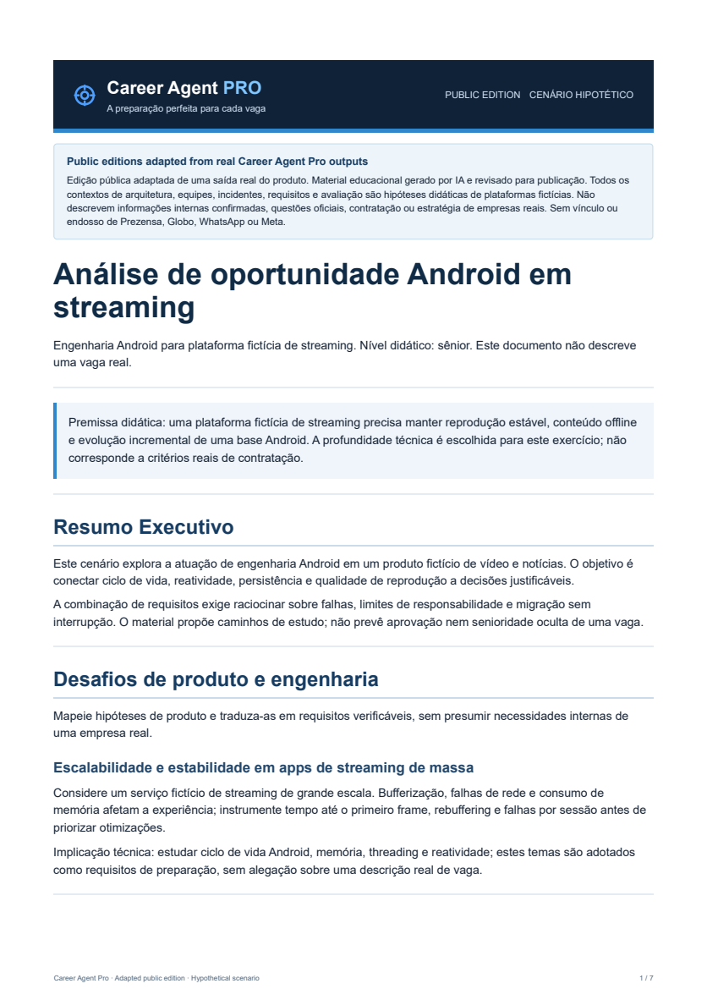
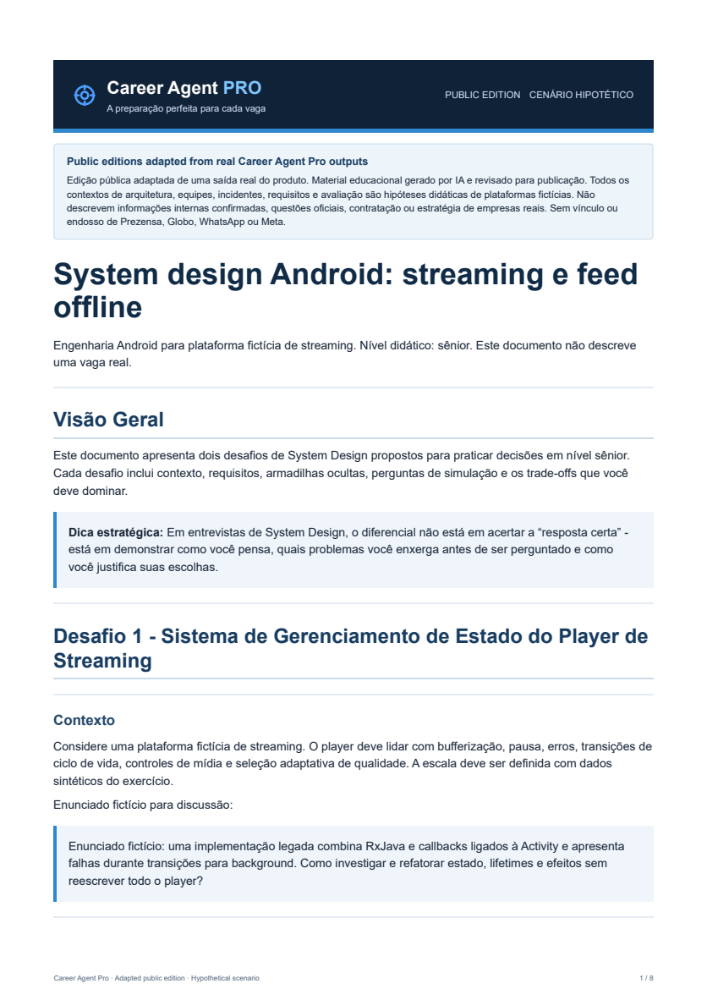
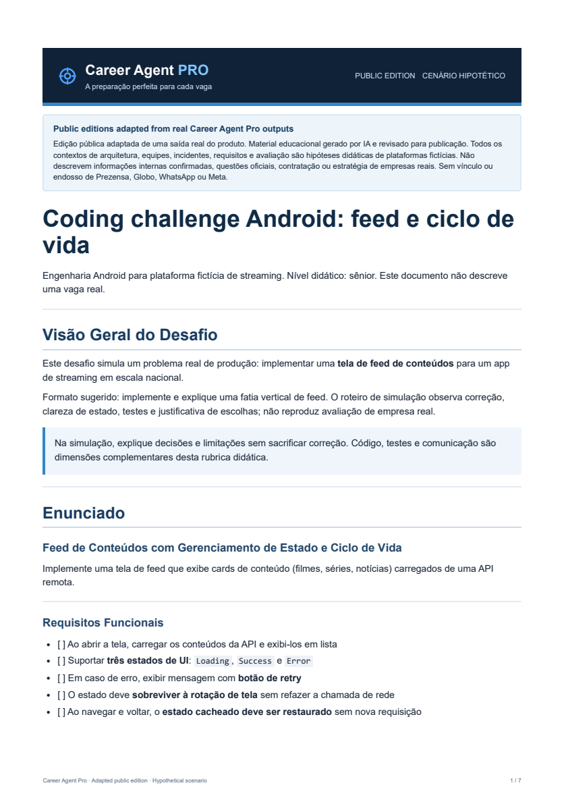
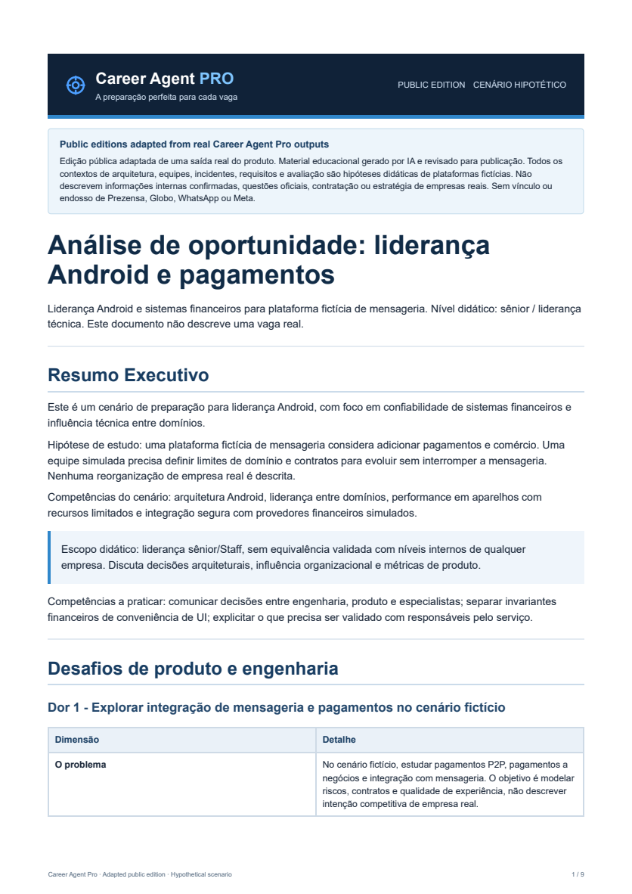
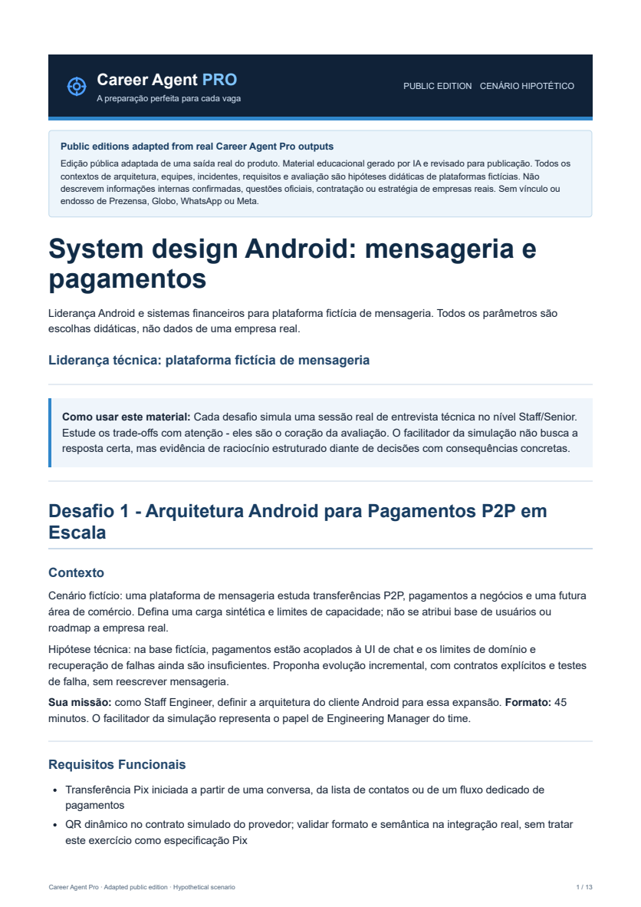
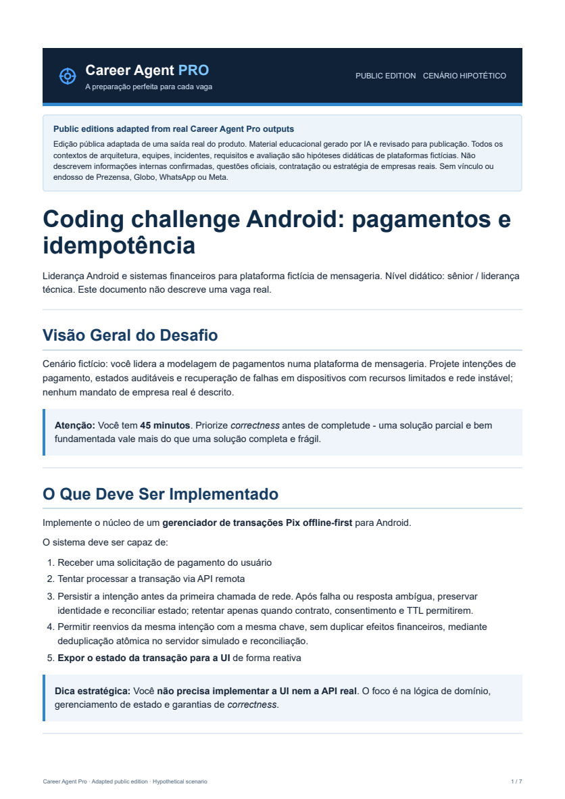

# Career Agent Pro — Real Outputs, Adapted Public Editions

> **Public editions adapted from real Career Agent Pro outputs.** These are educational materials for two hypothetical platforms: streaming, and messaging with financial systems. Architectures, team structures, incidents, metrics, requirements and assessment criteria are illustrative assumptions. They are not verified descriptions of real companies or official hiring materials. There is no affiliation with or endorsement by Prezensa, Globo, WhatsApp or Meta.

Career Agent Pro is a completed personal-use AI engineering product that produces personalized technical interview preparation materials using specialized agents and asynchronous processing. Its source code is private.

[Project website](https://www.career-agent-pro.com) · [Back to GitHub profile](../../README.md)

## Deliverables at a glance

| Scenario | Opportunity intelligence | System design | Technical challenge |
|---|---|---|---|
| **Hypothetical streaming platform — Android engineering** | [PDF](samples/prezensa-android/pdf/01-analise-de-inteligencia.pdf) · [HTML](samples/prezensa-android/html/01-analise-de-inteligencia.html) | [PDF](samples/prezensa-android/pdf/03-desafios-system-design.pdf) · [HTML](samples/prezensa-android/html/03-desafios-system-design.html) | [PDF](samples/prezensa-android/pdf/04-desafios-tecnicos.pdf) · [HTML](samples/prezensa-android/html/04-desafios-tecnicos.html) |
| **Hypothetical messaging platform — Android leadership & payments** | [PDF](samples/whatsapp-android/pdf/01-analise-de-inteligencia.pdf) · [HTML](samples/whatsapp-android/html/01-analise-de-inteligencia.html) | [PDF](samples/whatsapp-android/pdf/03-desafios-system-design.pdf) · [HTML](samples/whatsapp-android/html/03-desafios-system-design.html) | [PDF](samples/whatsapp-android/pdf/04-desafios-tecnicos.pdf) · [HTML](samples/whatsapp-android/html/04-desafios-tecnicos.html) |

## Visual preview

The previews below are first-page renders of the **rebuilt, adapted public PDFs**. Each PDF is generated from its corresponding adapted HTML source; both contain the same educational edition. Open either format to inspect the full exercises, code examples and architectural trade-offs.

### Hypothetical streaming platform — Android engineering

<table><tr>
<td align="center" width="33%"> <strong>Opportunity Intelligence</strong> <a href="samples/prezensa-android/pdf/01-analise-de-inteligencia.pdf">PDF</a> · <a href="samples/prezensa-android/html/01-analise-de-inteligencia.html">HTML</a></td>
<td align="center" width="33%"> <strong>System Design</strong> <a href="samples/prezensa-android/pdf/03-desafios-system-design.pdf">PDF</a> · <a href="samples/prezensa-android/html/03-desafios-system-design.html">HTML</a></td>
<td align="center" width="33%"> <strong>Technical Challenge</strong> <a href="samples/prezensa-android/pdf/04-desafios-tecnicos.pdf">PDF</a> · <a href="samples/prezensa-android/html/04-desafios-tecnicos.html">HTML</a></td>
</tr></table>

### Hypothetical messaging platform — Android leadership & payments

<table><tr>
<td align="center" width="33%"> <strong>Opportunity Intelligence</strong> <a href="samples/whatsapp-android/pdf/01-analise-de-inteligencia.pdf">PDF</a> · <a href="samples/whatsapp-android/html/01-analise-de-inteligencia.html">HTML</a></td>
<td align="center" width="33%"> <strong>System Design</strong> <a href="samples/whatsapp-android/pdf/03-desafios-system-design.pdf">PDF</a> · <a href="samples/whatsapp-android/html/03-desafios-system-design.html">HTML</a></td>
<td align="center" width="33%"> <strong>Technical Challenge</strong> <a href="samples/whatsapp-android/pdf/04-desafios-tecnicos.pdf">PDF</a> · <a href="samples/whatsapp-android/html/04-desafios-tecnicos.html">HTML</a></td>
</tr></table>

## About these samples

- These are **public editions adapted from authentic Career Agent Pro outputs**, selected from larger preparation packages. The original ZIP is preserved outside this repository and is not part of this public gallery.
- The gallery intentionally excludes candidate-specific profile assessments, personal CV revisions, and potentially sensitive applicant information.
- Legacy directory names identify the original scenario labels (Prezensa / Globo and WhatsApp / Meta). They do not attribute the adapted exercises to those companies. The public documents describe fictional platforms and make no claim of affiliation or endorsement.
- The gallery contains educational Kotlin contracts and examples, not product source code. It does not publish deployment configuration, agent prompts, customer data, credentials or private business logic.
- Public adaptations retain the two scenario domains and technical depth, with corrections to lifecycle management, player threading, notification delivery, background work and payment reconciliation. They do not reproduce official interview rubrics or predict hiring outcomes.
- GitHub can preview PDFs; the `.html` links may show their source rather than execute as webpages. Download HTML files to open locally.

## Product architecture (high-level)

**Node.js · Fastify · PostgreSQL · Redis · BullMQ · AI agents · PDF/HTML generation**

The product coordinates specialized agents for opportunity analysis, preparation planning and document assembly using an asynchronous job workflow. These samples focus on the generated outcomes rather than implementation details.
